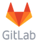
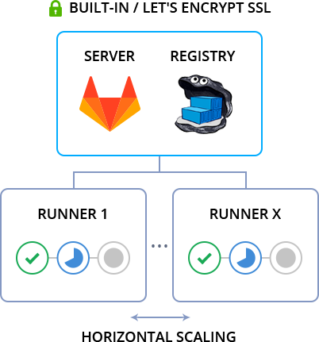
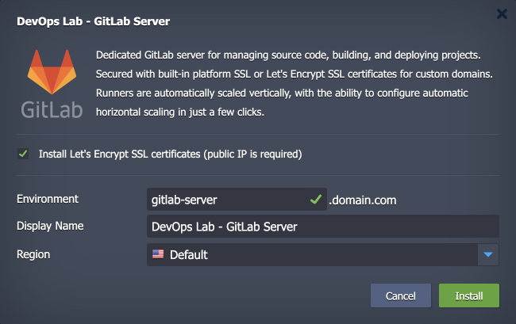
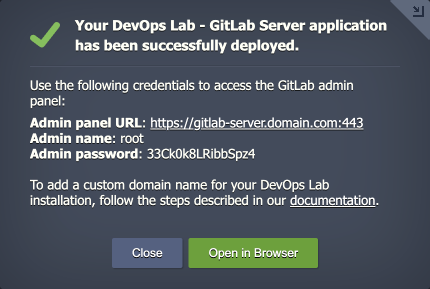

 

# DevOps Lab - GitLab Server

Dedicated GitLab server for managing source code, building, and deploying projects. Secured with built-in platform SSL or Let's Encrypt SSL certificates for custom domains. Runners are automatically scaled vertically, with the ability to configure automatic horizontal scaling in just a few clicks.

## Environment Topology

This package creates a dedicated **DevOps Lab** environment that contains two system containers - one for GitLab Server with Docker Hub Registry and the other one for GitLab Runner. The automatic vertical scaling is enabled out of the box, and [horizontal scaling](https://www.virtuozzo.com/application-platform-docs/automatic-horizontal-scaling/) can be configured for runners if needed. The default software stacks utilized in the package are the following:

- [Docker Engine CE](https://hub.docker.com/r/jelastic/dockerce) with docker-compose utility
- [GitLab Community Edition](https://github.com/jelastic/docker-gitlab)

 

Automation scripts inside the package perform the following actions:

- Creates two system containers with pre-installed Docker Engine CE and docker-compose utility.
- Generates and installs platform's [built-in SSL](https://www.virtuozzo.com/application-platform-docs/built-in-ssl/) or [Let’s Encrypt SSL certificates](https://www.virtuozzo.com/company/blog/free-ssl-certificates-with-lets-encrypt/), as well as shares them with Runners via NFS volume.
- Injects dynamic environment variables such as tokens, passwords, and environment domain.
- Deploys GitLab Server and Container Registry via [docker-compose.yml](https://github.com/jelastic/docker-gitlab/blob/master/docker-compose.yml) in one Docker Engine node.
- Creates one Runner in a separate Docker Engine and registers it automatically in GitLab Server.
- Automates discovery of newly added Runners upon horizontal scaling.

## Deployment to Cloud

To get your DevOps Lab solution, click the "**Deploy to Cloud**" button below, specify your email address within the widget, choose one of the [Virtuozzo Public Cloud Providers](https://www.virtuozzo.com/application-platform-partners/), and confirm by clicking **Install**.

> If you already have a Virtuozzo Application Platform (VAP) account, you can deploy this solution from the [Marketplace](https://www.virtuozzo.com/application-platform-docs/marketplace/) or [import](https://www.virtuozzo.com/application-platform-docs/environment-import/) a manifest file from this repository.

## Installation Process

In the opened installation window at the VAP dashboard, provide a preferred environment and display names, choose a region (if available), and confirm the installation. By default, the platform will issue a built-in SSL certificate for your application that will be valid for the platform domain. If you plan to use a custom domain name, check the optional box to attach public IP and get a free Let’s Encrypt SSL certificate.

Your DevOps Lab application will be automatically installed in a few minutes. Access credentials will be sent to your email address and displayed in the dashboard notification window.

